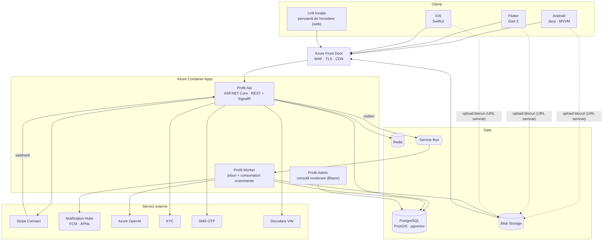
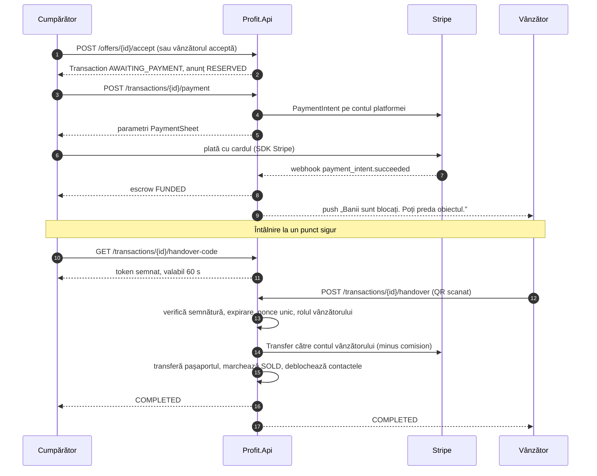

# Pasul 2a — Arhitectura de sistem

> Stare: **în așteptarea confirmării**. Decizii fixate: nume **Profit**, plăți **Stripe Connect**, backend pe **tehnologie Microsoft**.

## 1. Stiva aleasă

| Zonă | Alegere | De ce |
|---|---|---|
| Runtime / framework | **ASP.NET Core pe .NET 10 (LTS)**, C# | Suport pe termen lung, performanță foarte bună pe API-uri JSON, un singur limbaj pentru API, workeri și consola de moderare. |
| Formă | **Monolit modular** (un proces API + un proces Worker, același cod) | O echipă mică livrează un MVP în 12 săptămâni fără costul operațional al microserviciilor. Modulele au granițe stricte (proiecte separate, comunicare prin evenimente), deci pot fi extrase ulterior. |
| Bază de date | **PostgreSQL 17 + PostGIS + pgvector**, pe Azure Database for PostgreSQL (Flexible Server), prin EF Core + Npgsql + NetTopologySuite | Căutarea pe rază și potrivirile „Caut” sunt interogări spațiale; PostGIS e cel mai matur motor pentru asta, iar pgvector acoperă căutarea vizuală fără un al doilea sistem. Este singura componentă al cărei motor nu e Microsoft, dar rulează ca serviciu administrat Azure. **Alternativă 100% Microsoft:** Azure SQL (tip `geography`) — vezi §6. |
| Timp real | **SignalR** + Azure SignalR Service | Chat, confirmări de citire, actualizări de ofertă, locație live. Reconectare automată și fallback de transport incluse; clienți oficiali pentru Java și Swift, pachet matur pentru Dart. |
| Cache / stare volatilă | **Azure Cache for Redis** | Limitare OTP, chei de idempotență, nonce-urile QR-ului de predare, prezență în chat. |
| Fișiere | **Azure Blob Storage** + CDN (Azure Front Door) | Încărcarea reluabilă e nativă: clientul trimite blocuri direct în Blob (`Put Block`) cu URL semnat, serverul le asamblează. Nu avem nevoie de un server de upload separat. |
| Mesagerie internă | **Azure Service Bus** + tipar *transactional outbox* | Evenimentele (anunț publicat, escrow finanțat, predare confirmată) se scriu în aceeași tranzacție cu datele, apoi se publică. Nicio notificare sau potrivire pierdută la o cădere. |
| Căutare | MVP: **PostgreSQL** (full-text `romanian` + `unaccent`, trigram, PostGIS) în spatele `ISearchIndex`; ulterior **Azure AI Search** | La volum de MVP, un al doilea motor de căutare e cost fără beneficiu. Interfața permite mutarea fără schimbări în API. |
| AI | **Azure OpenAI** (model cu viziune) pentru sugestii de titlu/categorie/descriere; embeddings de imagine pentru căutarea vizuală | Date procesate în UE, același furnizor și aceeași facturare. Sugestiile sunt mereu editabile și cer consimțământ separat (`AI_PHOTO_PROCESSING`). |
| Notificări push | **Azure Notification Hubs** (FCM v1 + APNs) | Segmentare prin tag-uri (`topic:offers`, `city:cluj`), un singur API pentru ambele platforme. |
| Plăți | **Stripe Connect** (conturi Express, *separate charges and transfers*) în spatele `IPaymentProvider` | Banii se încasează pe platformă și se transferă vânzătorului abia la predare. Netopia se poate adăuga ca a doua implementare; contractul API are deja `provider` și `redirectUrl`. |
| Identitate | **OpenIddict** pe ASP.NET Core Identity: OTP prin SMS → JWT de 15 min + refresh token rotativ | OAuth2 standard, fără un serviciu de identitate extern. Reutilizarea unui refresh token vechi revocă toată familia. |
| KYC | Furnizor terț în spatele `IKycProvider` (candidat: Stripe Identity) | Un furnizor în minus de integrat și contractat. |
| Găzduire | **Azure Container Apps**, regiune UE; secrete în **Key Vault**; telemetrie **OpenTelemetry → Application Insights** | Scalare la zero pe staging, fără administrare de cluster. |
| CI/CD | GitHub Actions (build, teste, migrări, deploy) | Același loc cu aplicațiile mobile. |

## 2. Diagrama de sistem



## 3. Modulele backend-ului

Fiecare modul este un proiect .NET cu propria schemă PostgreSQL. Modulele nu-și citesc reciproc tabelele; comunică prin interfețe publice și evenimente de domeniu.

| Modul | Responsabilitate | Evenimente emise (exemple) |
|---|---|---|
| `Identity` | OTP, tokenuri, trepte de verificare, limite, consimțăminte, dispozitive | `UserVerified` |
| `Catalog` | Categorii, ghiduri de fotografiere, anunțuri, loturi, salvate, ecranul principal | `ListingPublished`, `ListingSold` |
| `Passport` | Pașaport, evenimente, transfer de proprietate | `PassportTransferred` |
| `Media` | Sesiuni de upload, eliminare EXIF, transcodare, mascare zone, embeddings | `MediaReady` |
| `Pricing` | Estimator din vânzări finalizate, reducere automată | `PriceDropped` |
| `Matching` | Cereri „Caut”, Dulap, potriviri | `MatchFound` |
| `Chat` | Conversații, mesaje, mascare contacte, detecție tipare de fraudă, hub SignalR | `MessageCreated` |
| `Deals` | Oferte (bani / troc / mixt), întâlniri, puncte sigure, partajare locație | `OfferAccepted` |
| `Payments` | Tranzacții, escrow, QR de predare, livrare, dispute, webhook-uri Stripe | `EscrowFunded`, `HandoverConfirmed` |
| `Reputation` | Recenzii pe atribute, insigne, contor de impact | `BadgeEarned` |
| `Moderation` | Raportări, moderare automată și umană, expuneri de motive, contestații (DSA) | `ContentActioned` |
| `Compliance` | Export / ștergere GDPR, retenție, praguri și raport DAC7, vânzători profesioniști | `Dac7ThresholdReached` |
| `Notifications` | Preferințe, segmentare, trimitere push | — |
| `Vehicles` | VIN, checklist, documente, alertă kilometraj | `MileageFlagged` |

Structura soluției:

```
backend/
├── src/
│   ├── Profit.Api/            # host: REST, SignalR, autentificare, OpenAPI
│   ├── Profit.Worker/         # host: joburi programate + consumatori Service Bus
│   ├── Profit.Admin/          # consolă de moderare
│   ├── Profit.SharedKernel/   # Money, Result, evenimente, outbox
│   └── Modules/
│       ├── Profit.Identity/   # fiecare: Domain / Application / Infrastructure / Endpoints
│       ├── Profit.Catalog/
│       └── …
└── tests/                     # xUnit: unitare, integrare (Testcontainers), contract față de openapi.yaml
```

## 4. Fluxul critic: escrow cu predare prin QR



Detalii de siguranță:

- **Tokenul QR** este `transactionId + nonce + expirare`, semnat HMAC pe server. Nonce-ul se consumă din Redis la prima folosire, deci o captură de ecran a QR-ului nu poate fi refolosită.
- **Cine scanează:** cumpărătorul arată, vânzătorul scanează. Cumpărătorul deține dovada plății și o prezintă doar după ce a văzut obiectul; vânzătorul nu poate elibera banii singur.
- **Cod de rezervă** din 6 cifre pentru cameră defectă sau lumină slabă, cu maximum 5 încercări.
- **Livrare prin curier:** un job din `Profit.Worker` eliberează escrow-ul la 48 h după livrare dacă nu există dispută; o dispută îngheață fondurile.
- **Idempotență:** `payment`, `handover` și webhook-urile Stripe sunt idempotente, deci o reîncercare pe rețea slabă nu dublează nicio operație.

## 5. Securitate și anti-fraudă la nivel de arhitectură

- **Chat:** mascarea linkurilor, IBAN-urilor, telefoanelor și emailurilor se face pe server, înainte de stocare și livrare; clientul primește textul deja mascat plus `maskedSpans`. Textul original nu ajunge niciodată la destinatar înainte de o tranzacție confirmată.
- **Detecția tiparelor de țeapă** (curier fals, plată prin link, avans) rulează sincron la trimitere, pe reguli; un clasificator se poate adăuga ulterior fără schimbări de contract (`safetyNotice`).
- **Imagini:** EXIF/GPS se elimină pe dispozitiv și încă o dată pe server. Bonurile sunt servite doar cu zonele sensibile deja acoperite; originalul nu e public.
- **Locație:** anunțurile expun coordonate rotunjite la ~300 m. Pozițiile din partajarea live nu se păstrează după expirarea linkului.
- **Transport:** TLS 1.3, certificate pinning în toate cele trei aplicații (cu pin de rezervă), tokenuri în Keystore / Keychain.
- **Date sensibile:** CNP-ul și datele DAC7 sunt criptate la nivel de coloană, cu chei în Key Vault, și se colectează doar la apropierea de prag.
- **Limite pe trepte:** telefon → email → act de identitate; `Identity` expune limitele, `Payments` le aplică.

## 6. Decizii de confirmat și puncte de verificat

1. **Baza de date.** Am ales PostgreSQL administrat de Azure pentru PostGIS și pgvector. Dacă „tehnologie Microsoft” înseamnă pentru tine și motorul bazei de date, trec pe **Azure SQL**: căutarea pe rază rămâne posibilă, dar căutarea vizuală s-ar muta în Azure AI Search din prima zi. Contractul API nu se schimbă în niciun caz.
2. **Numele „Profit”.** Există deja publicația financiară Profit.ro. Recomand o verificare de marcă la OSIM/EUIPO pentru clasele relevante înainte de a rezerva identificatorii din magazine. În cod folosesc provizoriu `ro.profit.app`.
3. **Escrow și reglementare.** Ținerea banilor între plată și predare e făcută de Stripe, nu de noi, dar durata maximă de reținere și încadrarea ca serviciu de plată trebuie validate cu Stripe și cu un jurist înainte de lansare.
4. **SMS OTP.** Furnizorul rămâne în spatele `ISmsSender`; disponibilitatea și costul pentru numere românești trebuie verificate înainte de alegere.
5. **Gazdele din `openapi.yaml`** (`api.profit.example`) sunt substituenți până la alegerea domeniului.
