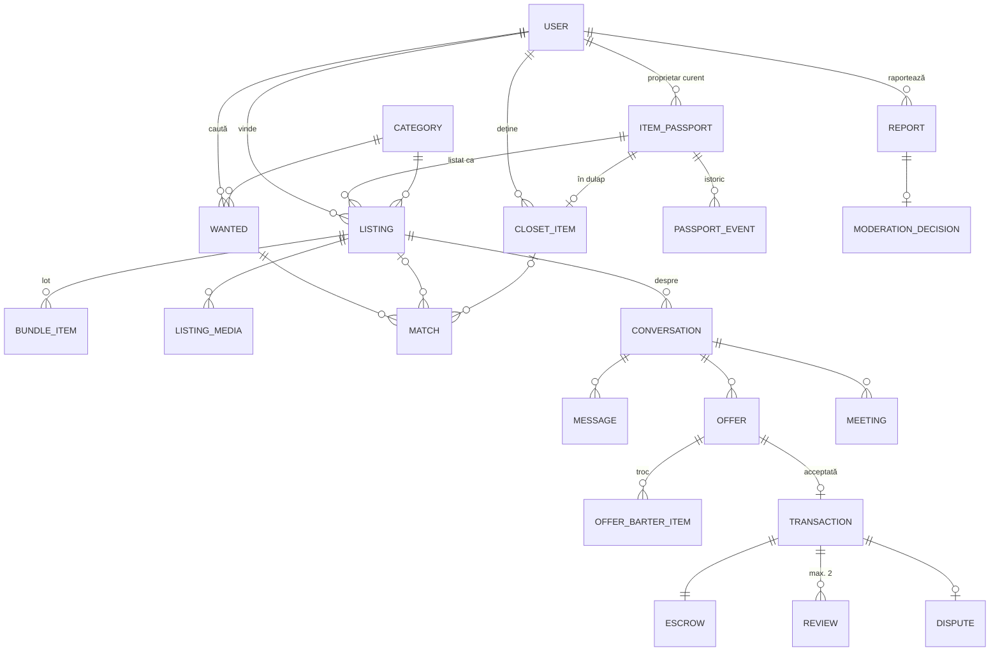
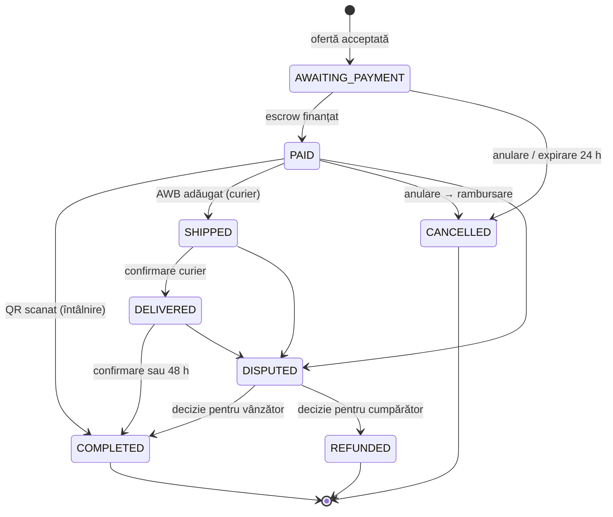

# Pasul 2b — Modelul de date

> Stare: **în așteptarea confirmării**. Specificația API corespunzătoare: [`api/openapi.yaml`](../api/openapi.yaml).

## 1. Ideea centrală: obiectul, nu anunțul

`ItemPassport` este identitatea permanentă a unui obiect fizic. `ClosetItem` și `Listing` sunt doar **stări** ale lui la un proprietar anume: ținut în dulap sau scos la vânzare. La vânzare, anunțul se închide, dar pașaportul își schimbă proprietarul și apare în dulapul cumpărătorului. De aceea `Listing.passport_id` și `ClosetItem.passport_id` trimit la aceeași înregistrare.

## 2. Diagrama entităților

## 3. Entitățile cerute

Toate tabelele au `id uuid` (UUID v7), `created_at`, `updated_at`. Sumele sunt `bigint` în unități minore plus `currency char(3)`.

### User

| Câmp | Tip | Note |
|---|---|---|
| `phone_e164` | text, unic | Treapta 1 de verificare |
| `email`, `email_verified_at` | text, timestamptz | Treapta 2 |
| `kyc_status`, `kyc_verified_at` | enum, timestamptz | Treapta 3; documentele rămân la furnizor |
| `display_name`, `avatar_media_id`, `city` | | Profil public |
| `home_location` | `geography(Point)` | Privat; folosit pentru „Aproape de tine” |
| `locale`, `currency` | `ro`/`en`, `RON`/`EUR` | |
| `seller_type` | `OCCASIONAL` / `PROFESSIONAL` | Profesioniștii au și `trader_info` (trasabilitate DSA) |
| `payout_account_ref` | text | ID-ul contului Stripe Connect |
| `status` | `ACTIVE` / `SUSPENDED` / `DELETION_PENDING` / `DELETED` | La ștergere, datele personale sunt anonimizate; tranzacțiile rămân pentru obligațiile fiscale |

Tabele asociate: `consent` (scop, versiune de politică, dată), `device` (token push), `notification_preference`, `tax_profile` (DAC7, criptat, creat doar la apropierea de prag), `refresh_token` (familie, hash).

### ItemPassport

| Câmp | Tip | Note |
|---|---|---|
| `current_owner_id` | → User | Se schimbă **doar** prin `HandoverConfirmed` |
| `category_id` | → Category | |
| `purchase_year`, `purchase_price` | int, bani | Opționale |
| `receipt_media_id` | → Media | Servit doar cu zonele sensibile acoperite |
| `selling_reason`, `selling_reason_note` | enum, text | |
| `serial_last4` | text | Ajută la detectarea obiectelor duplicate sau furate |
| `owner_count` | int | Derivat din evenimentele de transfer; identitățile foștilor proprietari nu se expun |

`PassportEvent`: `type` (`CREATED`, `REPAIR`, `SERVICE`, `NOTE`, `OWNERSHIP_TRANSFER`), `occurred_on`, `description`, `media`, `verified` (adevărat doar pentru evenimentele scrise de sistem), `transaction_id`. Tabel **doar cu adăugare**: evenimentele nu se editează și nu se șterg.

### Closet (`ClosetItem`)

| Câmp | Tip | Note |
|---|---|---|
| `owner_id`, `passport_id` | → User, → ItemPassport | Un singur `ClosetItem` activ per pașaport |
| `title`, `attributes` | text, jsonb | |
| `condition_grade` | 1–5 | Opțional până la listare |
| `alert_on_wanted` | bool | Alertă când apare o cerere „Caut” potrivită |
| `alert_price_above` | bani | Alertă când mediana pieței depășește pragul |
| `embedding` | `vector` | Pentru potriviri și căutare vizuală |

Privat: nu apare niciodată în căutare; doar proprietarul își vede potrivirile.

### Listing

| Câmp | Tip | Note |
|---|---|---|
| `seller_id`, `passport_id`, `category_id` | | `passport_id` e nul pentru loturi |
| `kind` | `SINGLE` / `BUNDLE` | `BUNDLE` = „Golesc casa” |
| `title`, `description`, `attributes` | text, text, jsonb | Pot proveni din sugestiile AI |
| `price`, `original_price` | bani | `original_price` se setează la prima reducere automată |
| `condition_grade` | 1–5 | **Calculat** din `condition_answers` și criteriile ghidului |
| `condition_answers`, `capture_guide_version` | jsonb, int | Dovada pe care se bazează nivelul |
| `location`, `location_public` | `geography(Point)` | Cea publică e rotunjită la ~300 m |
| `accepts_barter`, `barter_wishes` | bool, text | |
| `fulfilment_options` | `MEETUP` / `COURIER` | |
| `auto_drop_percent`, `auto_drop_interval_days`, `auto_drop_floor`, `next_drop_at` | | Reducerea automată |
| `status` | `DRAFT` → `IN_REVIEW` → `ACTIVE` → `RESERVED` → `SOLD`; sau `WITHDRAWN`, `REJECTED` | |
| `search_vector`, `embedding` | `tsvector`, `vector` | Căutare text și vizuală |

Asociate: `listing_media` (ordine, `shot_key`), `bundle_item` (titlu, preț, stare, `sold`), `bundle_discount_tier`, `saved_listing`, `vehicle_details` (VIN, kilometraj, ITP, documente).

Indexuri: GiST pe `location`, GIN pe `search_vector`, HNSW pe `embedding`, parțial pe `status = 'ACTIVE'`.

### Wanted

| Câmp | Tip | Note |
|---|---|---|
| `requester_id`, `category_id` | | |
| `title`, `description`, `attributes` | | |
| `budget_max`, `min_condition` | bani, 1–5 | |
| `location`, `radius_km`, `accepts_shipping` | | |
| `status` | `OPEN` / `FULFILLED` / `CLOSED` / `EXPIRED` | Expiră implicit după 60 de zile |

`Match`: `wanted_id`, `listing_id` **sau** `closet_item_id`, `score`, `notified_at`, `dismissed_at`. Generat asincron la `ListingPublished`, la crearea unei cereri și la adăugarea în dulap.

### Offer

| Câmp | Tip | Note |
|---|---|---|
| `conversation_id`, `listing_id`, `from_user_id` | | |
| `cash`, `cash_payer` | bani, `BUYER` / `SELLER` | La troc, diferența poate curge în oricare sens |
| `bundle_quote_id` | → BundleQuote | Pentru loturi |
| `counter_of_offer_id` | → Offer | Lanțul de contraoferte |
| `status` | `PENDING` / `ACCEPTED` / `DECLINED` / `COUNTERED` / `EXPIRED` / `WITHDRAWN` | Expiră după 48 h |

`OfferBarterItem`: `listing_id` sau `closet_item_id` oferit la schimb. Invariant: o ofertă are bani, obiecte sau ambele; o singură ofertă `ACCEPTED` per anunț.

### Transaction

| Câmp | Tip | Note |
|---|---|---|
| `offer_id`, `listing_id`, `buyer_id`, `seller_id` | | Prețul e înghețat la valoarea din ofertă |
| `fulfilment` | `MEETUP` / `COURIER` | |
| `status` | vezi mașina de stări | |
| `meeting_id` | → Meeting | |
| `carrier`, `tracking_number`, `delivered_at` | | Doar curier |
| `handover_attempts` | int | Limită pentru codul de rezervă |
| `completed_at` | | Alimentează estimatorul de preț, DAC7 și contorul de impact |

Trocul fără diferență în bani sare peste plată (`Escrow.status = NONE`), dar tot se încheie prin scanarea QR-ului, ca ambele pașapoarte să se transfere și recenziile să fie permise.

### Escrow

| Câmp | Tip | Note |
|---|---|---|
| `transaction_id` | unic | Relație 1:1 |
| `amount`, `platform_fee`, `seller_payout` | bani | |
| `provider`, `provider_payment_ref`, `provider_transfer_ref` | | Stripe: PaymentIntent și Transfer |
| `status` | `NONE` / `AWAITING_PAYMENT` / `FUNDED` / `RELEASED` / `REFUNDED` / `FROZEN` | |
| `funded_at`, `auto_release_at`, `released_at` | | `auto_release_at` = livrare + 48 h |

Fiecare schimbare de stare se scrie și în `escrow_ledger` (doar cu adăugare), pentru audit și reconciliere cu Stripe.

### Review

| Câmp | Tip | Note |
|---|---|---|
| `transaction_id`, `reviewer_id`, `subject_id` | | Unic pe (`transaction_id`, `reviewer_id`) |
| `attributes` | set de `PUNCTUAL`, `AS_DESCRIBED`, `RESPONDS_FAST`, `CAREFUL_PACKAGING`, `FAIR_NEGOTIATION` | Fără notă numerică |
| `private_note` | text | Vizibil doar moderatorilor |

`user_badge` (derivat): `user_id`, `attribute`, `confirmations`. Insigna devine publică peste un prag minim de confirmări. `RESPONDS_FAST` se calculează și din timpii reali de răspuns din chat, nu doar din recenzii.

### Report

| Câmp | Tip | Note |
|---|---|---|
| `reporter_id` | → User | |
| `target_type`, `target_id` | `LISTING` / `MESSAGE` / `USER` / `WANTED` | |
| `reason`, `details` | enum, text | |
| `status` | `RECEIVED` / `IN_REVIEW` / `ACTION_TAKEN` / `NO_ACTION` / `APPEALED` | |

`ModerationDecision`: `decision`, `legal_or_terms_ground`, `explanation`, `automated`, `moderator_id`, `decided_at`. Aceasta este expunerea de motive cerută de DSA; se trimite utilizatorului afectat și stă la baza raportului de transparență. `Appeal` leagă o contestație de decizie și este mereu rezolvată de un om.

## 4. Entități de suport

| Entitate | Rol |
|---|---|
| `Category`, `CaptureGuide` | Arborele de categorii; cadrele cerute și criteriile de stare, versionate |
| `Media`, `UploadSession` | Fișiere, blocuri primite, stare de procesare |
| `Conversation`, `Message` | Chat; `Message` păstrează textul mascat, zonele mascate și avertismentul de siguranță |
| `Meeting`, `SafeSpot`, `LocationShare` | Întâlniri, puncte sigure, link temporar de locație |
| `Dispute` | Motiv, dovezi, decizie |
| `PriceSample` | Proiecție denormalizată a vânzărilor finalizate, pe categorie, atribute și stare — sursa estimatorului |
| `ImpactFactor` | Factori CO₂ și deșeuri pe categorie, cu versiune de metodologie |
| `OutboxMessage`, `IdempotencyKey` | Livrare garantată a evenimentelor; reîncercări sigure |
| `AuditLog` | Acțiuni ale moderatorilor și accesări de date sensibile |

## 5. Retenție (GDPR)

| Date | Păstrare |
|---|---|
| Cont șters | Anonimizare după 30 de zile de grație |
| Mesaje | 24 de luni de la ultima activitate; păstrate pe durata unei dispute |
| Tranzacții, registrul escrow | 10 ani (obligații contabile și fiscale) |
| Date DAC7 | Colectate la apropierea de prag; păstrate cât cere raportarea |
| Poziții din partajarea live | Șterse la expirarea linkului |
| Ciorne nepublicate | 90 de zile |
| Decizii de moderare | Cât cere raportarea de transparență DSA |

Termenele sunt propuneri de pornire și trebuie validate juridic.
